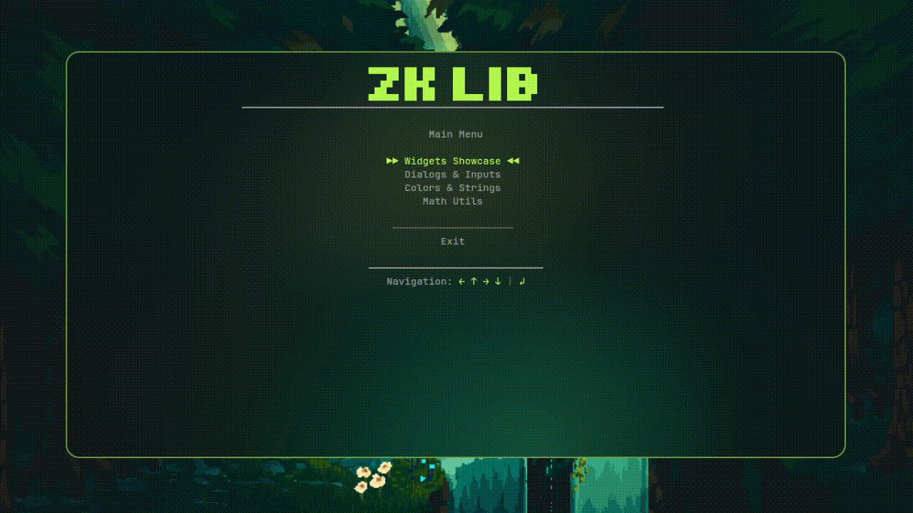
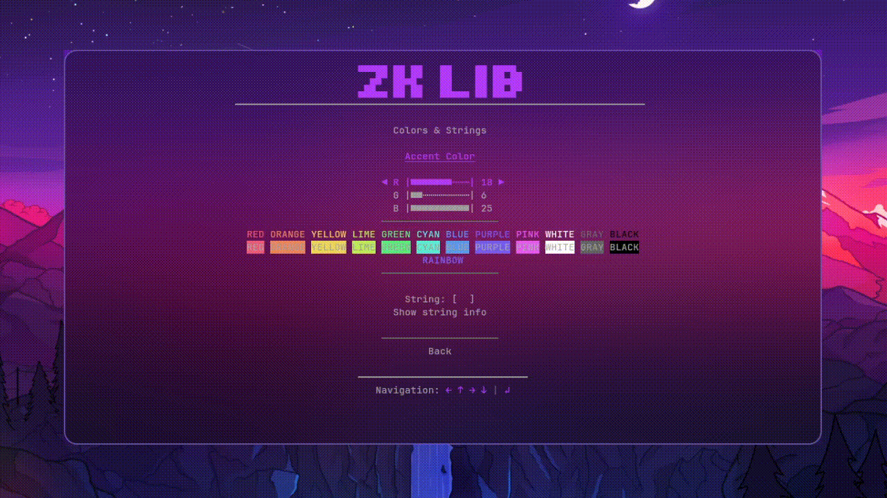
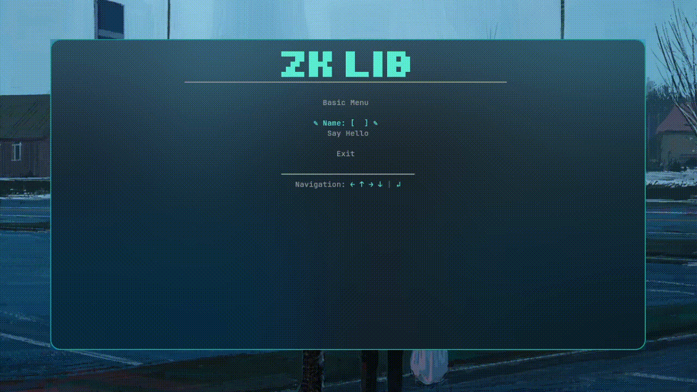
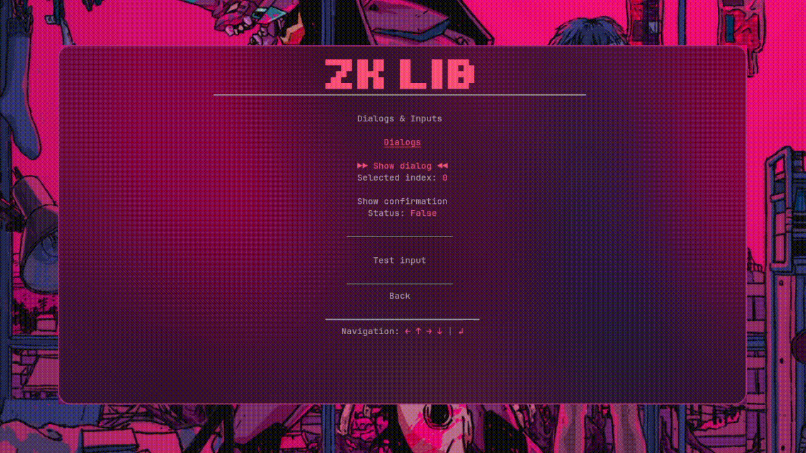

# zk_lib.hpp

> Simple, zero-dependency single-header C++ helper for terminal manipulation, ANSI colors, and interactive CLI menus.

This project started as a personal helper to speed up my university assignments and gradually evolved into a small TUI toolkit. It abstracts low level terminal handling across **Windows**, **Linux**, and **macOS** without requiring external dependencies like `ncurses`.




## Features

* **Cross-Platform Terminal Control:** Unified API over `WinAPI`/`conio.h` on Windows and `termios`/`ioctl`/`select` on POSIX systems (Linux & macOS).
* **Raw Keyboard Input:** Blocking and non-blocking key detection (`get_key`), including arrow keys and escape sequences.
* **Interactive Menu System:** Stack-based submenu navigation (`menuManager`) with polymorphic widgets:
  * `button`, `selector`, `slider`, `checkbox`, `textfield` (with password masking), `progress_bar`, `text_label`, `separator`, and `spacer`.
* **Dialogs & Prompts:** Centered selection dialogs, animated loading spinners, confirmation prompts, and UTF-8 aware inline text input.
* **ANSI & UTF-8 Utilities:** 24-bit TrueColor RGB support, cursor positioning, and string helpers that accurately count multi-byte UTF-8 characters while ignoring ANSI escape codes.
* **Buffered Output:** A shared `out_stream` buffers terminal output, displays complete frames, and can restore the last frame after a dialog or other overlay.
* **Zero Dependencies:** Just drop a single `.hpp` file into your project and compile.

## API

All public names documented below belong to the `zk` namespace.

### Program lifecycle

Call `init_program()` once near the start of `main()` and `exit_program()` before returning. Both functions are cross-platform.

```cpp
int main()
{
    zk::init_program();

    // Program code

    zk::exit_program();
    return 0;
}
```

* `void init_program()`: enables raw terminal input, hides the cursor, enters alternate-screen mode, sets UTF-8 output on Windows, and initializes the random seed.
* `void exit_program()`: restores terminal settings, shows the cursor, and leaves alternate-screen mode.
* `void sleep(int ms)`: pauses execution for the specified number of milliseconds.
* `size_t get_terminal_width()` / `size_t get_terminal_height()`: return the current terminal dimensions.

---

### Buffered output

The shared `zk::output` stream buffers a complete terminal frame before printing it:

```cpp
zk::output << "\e[H" << "Hello, terminal!";
zk::output.show();
```

* `operator<<`: appends any stream-compatible value to the current frame.
* `print(value)`: appends a value directly to the current frame.
* `stream()`: returns the underlying `std::ostream` for use with stream operations.
* `show(bool remember = true)`: prints the current frame and optionally stores it as the previous frame.
* `show(false)`: prints an overlay without replacing the remembered frame.
* `show_previous()`: reprints the last remembered frame.
* `clear_current()`: discards only the frame currently being composed.
* `clear()`: discards both the current and remembered frames.

Dialogs and menu text fields use `show(false)` and `show_previous()` to restore the screen when they close.

---

### Cursor and screen control

These functions append terminal escape sequences to `zk::output`; call `show()` or `output.show()` to display them.

* `clear()`: clears the screen and moves the cursor to `(1, 1)`.
* `clear_line()`: clears the current line and returns the cursor to its beginning.
* `cursor_save_pos()` / `cursor_load_pos()`: save or restore the cursor position.
* `cursor_move_up(lines)`, `cursor_move_down(lines)`, `cursor_move_right(columns)`, `cursor_move_left(columns)`: move the cursor relative to its current position.
* `cursor_move_to(x, y)`: move the cursor to an absolute 1-based terminal position.
* `cursor_to_begin_line()`: move the cursor to the beginning of the current line.
* `hide_cursor()` / `show_cursor()`: hide or show the terminal cursor.

```cpp
zk::cursor_move_to(10, 5);
zk::output << "Positioned text";
zk::output.show();
```

The library also exposes `zk::terminal_width` and `zk::terminal_height`, updated when menus and dialogs render.

---

### Keyboard input

* `get_key(bool blocking = true)`: waits for or checks for a key. With `blocking == false`, it returns `""` immediately when no key is available.
* `has_input(int timeout_ms = 0)`: POSIX-only availability check; returns whether standard input has data within the timeout.

The constants `key_up`, `key_down`, `key_left`, `key_right`, `key_intro`, and `key_esc` contain the platform-specific key sequences.

```cpp
std::string key = zk::get_key();

if (key == zk::key_esc)
{
    // Escape was pressed
}
```

`get_key(false)` is suitable for a menu or game render loop.

---

### Colors and text styles

* `color_rgb(R, G, B, bg = false)`: returns a 24-bit ANSI foreground color; set `bg` to `true` for a background color.
* `f_clear`: resets all text formatting.
* `bold` / `underline`: ANSI bold and underline prefixes.

Built-in colors include `c_white`, `c_gray`, `c_black`, `c_green`, `c_cyan`, `c_blue`, `c_purple`, `c_pink`, `c_red`, `c_orange`, `c_yellow`, and `c_lime`.

```cpp
zk::output << zk::c_green << zk::bold << "Success" << zk::f_clear;
zk::output.show();
```



---

### Custom input

`zk::input()` reads editable, UTF-8-aware text directly from the terminal:

```cpp
std::string input(
    std::string prompt       = "",
    std::string prompt_color = "",
    std::string input_color  = "",
    size_t max_length        = 64,
    size_t centered          = 0,
    bool password_mode       = false,
    bool menu_mode           = false,
    std::string default_text = "",
    size_t dialog_width      = 0
);
```

It is blocking, returns the entered text, and automatically shows and hides the terminal cursor.

| Parameter | Default | Description |
| --- | --- | --- |
| `prompt` | `""` | Text displayed before the input field. |
| `prompt_color` | `""` | ANSI color prefix used for `prompt`. |
| `input_color` | `""` | ANSI color prefix used for the entered text. |
| `max_length` | `64` | Maximum accepted UTF-8 character count. |
| `centered` | `0` | Terminal width used to center the line; `0` disables centering. |
| `password_mode` | `false` | Displays typed characters as bullets (`•`) while returning the original text. |
| `menu_mode` | `false` | Displays the field in a centered dialog and restores the previous frame afterward. |
| `default_text` | `""` | Initial value placed in the input field. |
| `dialog_width` | `0` | Interior width of the dialog in menu mode; `0` chooses the width automatically. |

Keyboard controls:

* Left / Right: move through the text.
* Backspace: delete the character before the cursor.
* Enter: accept and return the text.
* Tab and Up / Down: ignored.
* Escape with `menu_mode`: restore `default_text` and close the input.

Inline example:

```cpp
std::string name = zk::input(
    "Name: ",
    zk::c_gray,
    zk::c_white,
    32,
    zk::get_terminal_width()
);
```

Password example:

```cpp
std::string password = zk::input(
    "Password: ",
    zk::c_gray,
    zk::c_white,
    64,
    0,
    true
);
```

Dialog example:

```cpp
std::string server = zk::input(
    "Server:",
    zk::c_gray,
    zk::c_white,
    64,
    zk::get_terminal_width(),
    false,
    true,
    "localhost"
);
```

In dialog mode the field scrolls horizontally so the cursor remains visible. Escape returns `default_text`; Enter returns the current text.



---

### Dialogs and prompts

* `wait(message = "Press any key to continue")`: prints a centered bottom banner and blocks until a key is pressed.
* `dialog(message, options = {"Ok"}, loading_mode = false, loading_sec = 0)`: shows a centered dialog and returns the selected option index. In loading mode it displays an animation for `loading_sec` seconds.
* `confirm(message)`: shows a Yes/No dialog and returns `true` only for Yes.
* `exit_program_confirm()`: asks `"Exit the program?"` and returns the user's choice.
* `exec_repeat(code)`: executes a function/lambda, then repeatedly asks whether it should run again.

```cpp
int choice = zk::dialog(
    "Choose a level",
    {"Easy", "Normal", "Hard"}
);

if (zk::confirm("Start the game?"))
{
    zk::dialog("Loading", {}, true, 2);
}
```



---

### Titles and layout helpers

* `print_title(lines, color = "", centered = true, draw_separator = true)`: clears the screen and prints a title, optionally centered with a separator.
* `print_footer(str)`: prints one or more newline-separated footer lines centered near the bottom.
* `center(text, width = terminal_width)`: left-pads text to center it in the requested width.
* `string_repeat(substring, n)`: repeats a string `n` times.
* `string_split(text, delimiter)`: splits a string around a character.
* `string_length(text, ignore_ansi = true)`: counts UTF-8 characters while ignoring ANSI sequences by default.
* `string_lower(str)` / `string_upper(str)`: return lowercase or uppercase copies.

```cpp
zk::print_title({
    "My Application",
    "Main menu"
});
```

---

### Values and containers

* `clamp(value, min, max)`: changes an integer so it remains inside the inclusive range.
* `wrap(value, min, max)`: changes an integer cyclically so it wraps inside the inclusive range.
* `in_range(value, min, max)`: returns whether a numeric value is inside the inclusive range.
* `irandom(a, b)`: returns a random inclusive integer between `a` and `b`.
* `exist(container, element)` / `exist_at(container, element)`: check for an element and return whether or where it is found.
* `wipe(container, element)` / `reverse(container)`: remove an element or reverse a `std::vector`.

---

### Numeric helpers

* `is_valid_number(str)`: validates integers, decimals, signed values, and scientific notation.
* `to_number<T>(str)`: converts a string to `int`, `long`, `long long`, `unsigned long`, `unsigned long long`, `float`, or `double`.
* `is_even(n)` / `is_prime(n)`: check basic integer properties.
* `fancy_number(n)`: converts digits to Unicode seven-segment characters.

```cpp
if (zk::is_valid_number("1.25e3"))
{
    double value = zk::to_number<double>("1.25e3");
}
```

---

### Menus

Create a menu, add widgets, configure callbacks, and display it by calling `show()`.

```cpp
menu settings("Settings");

bool enabled = false;
int volume = 50;

settings.set_color(zk::c_green);
settings.add_checkbox("Enabled", enabled);
settings.add_slider("Volume", volume, 0, 100);
settings.add_button("Back", [&settings]() {
    settings.close();
});

settings.show();
```

Available menu methods:

* `add_button(text, callback)`: executes a callback when Enter is pressed.
* `add_selector(text, options, selected_index)`: provides an options selector controlled with Left / Right.
* `add_slider(text, value, min, max)`: provides an integer slider controlled with Left / Right.
* `add_checkbox(text, checked)`: provides a boolean checkbox toggled with Enter.
* `add_textfield(text, value, password_mode = false, dialog_width = 0, max_length = 64)`: opens an editable UTF-8 dialog when Enter is pressed. A width of `0` selects it automatically.
* `add_label(text_function, color = "", use_accent = false)`: draws a dynamic text label updated before every frame.
* `add_br(lines = 1)`: adds blank lines.
* `add_separator(line_width = 20, pattern = "─", color = c_gray)`: adds a decorative separator.
* `add_progress(text, value, max)`: draws a read-only progress bar.
* `set_ascii_title(lines)`: Sets an ASCII art title above the menu.
* `set_color(color)` / `get_color()`: configure or retrieve the menu accent.
* `on_loop(callback)`: run a callback before every frame is drawn.
* `set_on_escape(callback)`: handle Escape for the menu.
* `close()`: stop the menu loop.
* `show()`: render and run the menu until it is closed.

For example, `menu.add_textfield("Name", name, false, 48, 24)` sets the dialog's interior width to 48 characters and the input limit to 24 UTF-8 characters. The dialog width is capped to fit the terminal.

<!-- GIF placeholder: interactive menu widgets -->

#### Menu widget reference

| Widget | Interaction |
| --- | --- |
| `button` | Runs a callback on Enter. |
| `selector` | Cycles through string options with Left / Right. |
| `slider` | Changes an integer with Left / Right. |
| `checkbox` | Toggles a boolean with Enter. |
| `textfield` | Opens `input()` in a dialog on Enter. |
| `text_label` | Displays static or dynamic non-focusable text. |
| `spacer` | Adds non-focusable vertical space. |
| `separator` | Displays a non-focusable separator. |
| `progress_bar` | Displays a non-focusable clamped progress value. |

#### Updating menu state

Use `on_loop()` to run a callback on each menu update, before the widgets are drawn:

```cpp
int updates = 0;

menu status("Status");
status.add_label([&updates]() {
    return "Updates: " + std::to_string(updates);
});
status.on_loop([&updates]() {
    ++updates;
});
```

Keep update callbacks short and non-blocking so menu input and rendering remain responsive.

#### Submenus

Use `menu_manager` to navigate through a stack of menus:

```cpp
menu main_menu("Main");
menu options("Options");
menu_manager manager;

main_menu.add_button("Options", [&manager, &options]() {
    manager.submenu_goto(options);
});

manager.exec(main_menu);
```

* `submenu_goto(submenu)`: push and activate a submenu.
* `submenu_return()`: close the active submenu and return to the previous one.
* `exec(starting_menu)`: start the menu stack with a starting menu.

## Examples

The [`examples/`](examples/) directory contains standalone programs that demonstrate the library:

* [`basic_menu.cpp`](examples/basic_menu.cpp): a small menu showcase.
* [`games.cpp`](examples/games.cpp): a menu-driven collection of Tic-Tac-Toe, Minesweeper, and Wordle.
* [`showcase.cpp`](examples/showcase.cpp): a full feature showcase covering menus, widgets, dialogs, colors, strings, and math utilities.

The examples require a C++14-compatible compiler. From the repository root, build and run them with:

```sh
g++ -std=c++14 examples/basic_menu.cpp -o basic_menu
./basic_menu

g++ -std=c++14 examples/games.cpp -o games
./games

g++ -std=c++14 examples/showcase.cpp -o showcase
./showcase
```

Run them in a UTF-8 terminal with ANSI color support. Use the arrow keys to navigate menus; the in-game screens show the controls for each game.

## Licence
Distributed under the MIT Licence
