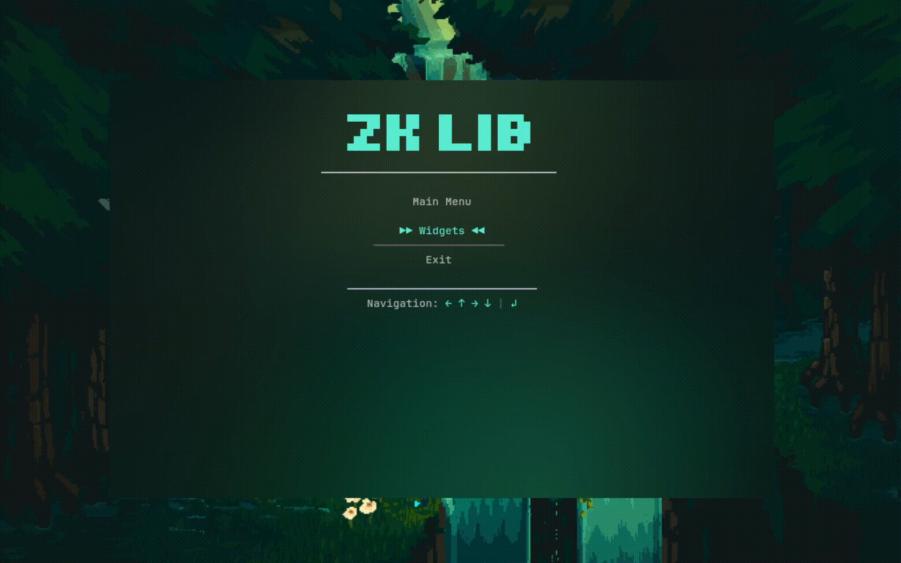

# zk_lib.hpp

> Simple, zero-dependency single-header C++ helper for terminal manipulation, ANSI colors, and interactive CLI menus.

This project started as a personal helper to speed up my university assignments and gradually evolved into a small TUI toolkit. It abstracts low level terminal handling across **Windows**, **Linux**, and **macOS** without requiring external dependencies like `ncurses`.




## Features

* **Cross-Platform Terminal Control:** Unified API over `WinAPI`/`conio.h` on Windows and `termios`/`ioctl`/`select` on POSIX systems (Linux & macOS).
* **Raw Keyboard Input:** Blocking and non-blocking key detection (`get_key`), including arrow keys and escape sequences.
* **Interactive Menu System:** Stack-based submenu navigation (`menuManager`) with polymorphic widgets:
  * `button`, `selector`, `slider`, `checkbox`, `textfield` (with password masking), `progress_bar`, `text_label`, `separator`, and `spacer`.
* **Dialogs & Prompts:** Centered selection dialogs, animated loading spinners, confirmation prompts, and UTF-8 aware inline text input.
* **ANSI & UTF-8 Utilities:** 24-bit TrueColor RGB support, cursor positioning, and string helpers that accurately count multi-byte UTF-8 characters while ignoring ANSI escape codes.
* **Zero Dependencies:** Just drop a single `.hpp` file into your project and compile.

## Examples

The [`examples/`](examples/) directory contains standalone programs that demonstrate the library:

* [`basic_menu.cpp`](examples/basic_menu.cpp): a small menu and widget showcase.
* [`games.cpp`](examples/games.cpp): a menu-driven collection of Tic-Tac-Toe, Minesweeper, and Wordle.

Both examples require a C++14-compatible compiler. From the repository root, build and run them with:

```sh
g++ -std=c++14 examples/basic_menu.cpp -o basic_menu
./basic_menu

g++ -std=c++14 examples/games.cpp -o games
./games
```

Run them in a UTF-8 terminal with ANSI color support. Use the arrow keys to navigate menus; the in-game screens show the controls for each game.

## Licence
Distributed under the MIT Licence
